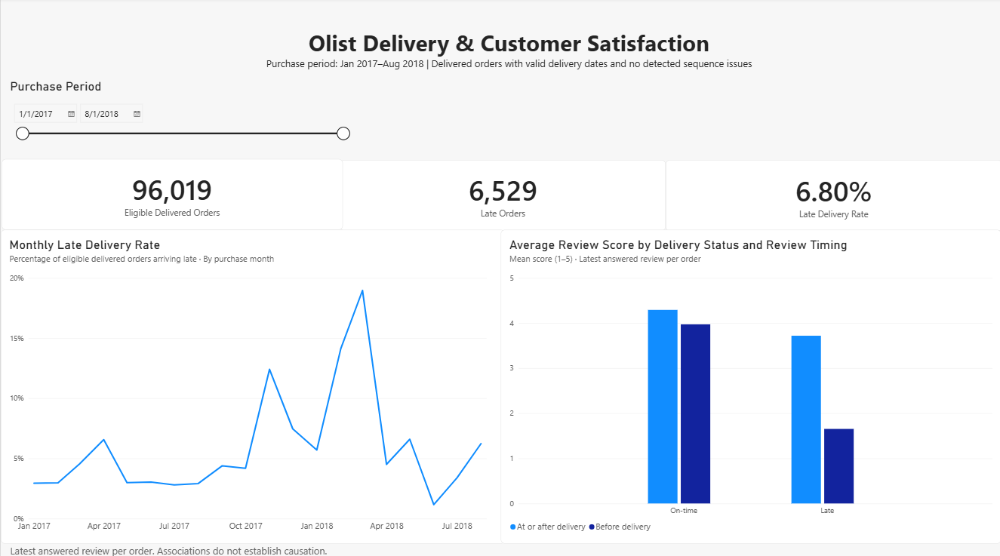

# Olist Delivery & Customer Satisfaction Analysis

Analyzing delivery performance and its relationship with customer
review scores using PostgreSQL and Power BI.

## Dashboard

[Download the Power BI report](dashboard/olist_delivery_customer_satisfaction.pbix)

## Business Objective

Identify changes in delivery performance over time and examine how
review scores differ between on-time and late orders.

The intended audience is a marketplace operations team evaluating
delivery performance and areas requiring further investigation.

## Business Questions

1. How does the late delivery rate change by purchase month?
2. How do review scores differ between on-time and late orders?
3. How does review timing affect the interpretation of these differences?

## Tools

- PostgreSQL and pgAdmin 4: data preparation, validation, and analysis
- Power BI: data modeling, DAX measures, and interactive visualization
- Git and GitHub: version control and documentation

## Dataset

Source: [Brazilian E-Commerce Public Dataset by Olist](https://www.kaggle.com/datasets/olistbr/brazilian-ecommerce)

Source tables used:
- Orders
- Order reviews

The raw orders table contains 99,441 orders.

## Analysis Scope

The dashboard includes 96,019 orders that:
- Were purchased from January 2017 through August 2018.
- Have a delivered status.
- Have actual and estimated delivery dates.
- Have no detected timestamp sequence issues under the checks performed.

Of these orders:
- 95,377 have a matching review.
- 642 do not have a matching review.

Orders without reviews remain included in delivery KPIs but are
excluded from review score calculations.

## KPI Definitions

| Metric | Definition |
|---|---|
| Eligible Delivered Orders | Orders meeting the analysis criteria |
| Late Orders | Eligible orders received after the estimated delivery date |
| Late Delivery Rate | Late orders divided by eligible delivered orders |
| Average Review Score | Mean of the selected review scores, on a 1–5 scale |
| Low Review Rate | Percentage of reviewed orders with a score of 1 or 2 |

Delivery classification compares calendar dates, ignoring the time
of day. Orders arriving on or before the estimated date are on time.

For orders with multiple review rows, the latest answered review
is selected to give each order equal weight.

Review timing is classified by comparing the review answer timestamp
with the recorded customer delivery timestamp.

## Key Findings

### 1. Overall delivery performance

- Eligible delivered orders: 96,019
- Late orders: 6,529
- Late delivery rate: 6.80%

### 2. March 2018 had the highest monthly late delivery rate
within the main analysis period

Of 7,003 eligible orders purchased in March 2018,
1,328 arrived late: a late delivery rate of 18.96%.

The month represents purchase month, not delivery month.

### 3. Late orders had lower average review scores

Using the latest answered review per order:
- On-time orders: 4.29 average score
- Late orders: 2.27 average score

### 4. Review timing materially changes the comparison

| Delivery status | Review answer timing | Reviewed orders | Average score | Low review rate |
|---|---|---:|---:|---:|
| On-time | Before delivery | 176 | 3.97 | 17.05% |
| On-time | At or after delivery | 88,825 | 4.29 | 9.23% |
| Late | Before delivery | 4,470 | 1.65 | 80.74% |
| Late | At or after delivery | 1,906 | 3.72 | 19.46% |

Among reviewed late orders, approximately 70.11% had their selected
review answered before the recorded delivery timestamp.

These are comparisons between different groups, not evidence that
individual customers increased their scores after receiving an order.

## Data Quality Decisions

- Preserved source records in the raw schema.
- Confirmed that order IDs are unique and not NULL.
- Identified 8 delivered orders without actual delivery timestamps.
- Identified 188 delivered orders with timestamp sequence issues.
- Excluded records failing the dashboard eligibility checks.
- Found 547 orders with multiple review rows, including 202 with
  different scores.
- Confirmed review scores are within 1–5.
- Confirmed there were no ties at the latest review answer timestamp.
- Validated the dashboard view has one row per order.

The quality counts above refer to the source data checks and are
not all restricted to the dashboard purchase period.

## Recommendations

1. Investigate operational conditions affecting orders purchased
   in March 2018 before attributing the spike to a specific cause.
2. Evaluate proactive communication for customers whose orders
   are approaching or exceeding their estimated delivery date.
3. Separate pre-delivery and post-delivery feedback in reporting
   so their different contexts remain visible.

Suggested evaluation metrics include late delivery rate,
low review rate, and customer contact volume where available.

These are proposed actions. Their business impact has not been tested.

## Limitations

- Review scores are an indicator of satisfaction, not a dedicated
  CSAT survey.
- Associations do not establish causation.
- Product quality, seller characteristics, and other factors have
  not been controlled for.
- The latest review is an analytical selection rule, not proof that
  it represents a revision of an earlier review.
- Recorded timestamps may contain errors beyond those detected.
- Results describe eligible delivered orders, not all purchases.
- Historical data coverage is not guaranteed to be complete.
- Geographic and product-category analysis are outside the current scope.

## Repository Structure

- sql/: table setup, quality checks, views, and analysis queries
- dashboard/: Power BI report
- images/: dashboard screenshot
- README.md: project documentation

## How to Reproduce

1. Download and extract the source dataset.
2. Create a PostgreSQL database named olist_analytics.
3. Run 01_create_orders_table.sql and import the original orders CSV
   into raw.orders with CSV headers enabled.
4. Run scripts 02–04.
5. Run 05_create_reviews_table.sql and import the original reviews CSV
   into raw.reviews with CSV headers enabled.
6. Run scripts 06–09.
7. Open the Power BI report.
8. Update the PostgreSQL data source connection for your environment
   and refresh the report.

Use your own database credentials. Do not commit passwords.